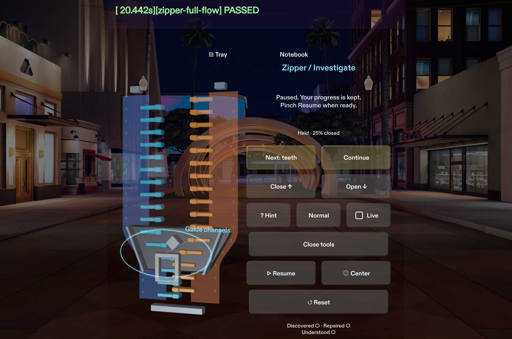
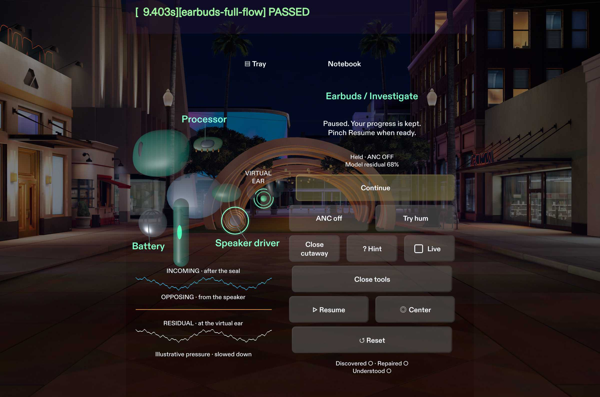
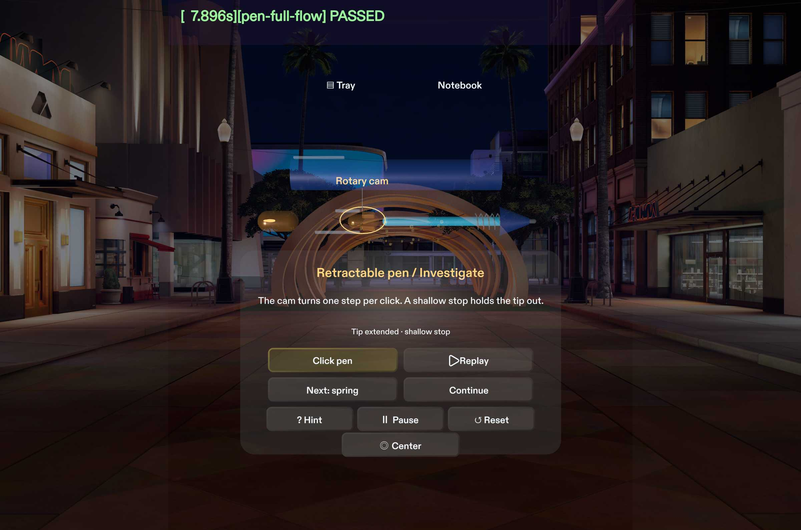
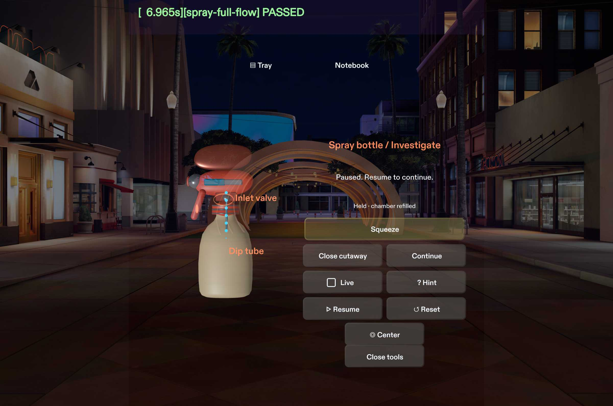

# ThingWhy

Open up a zipper, noise-cancelling earbud, retractable pen, or trigger spray bottle in AR and test what makes it work.

## Demo

[](https://youtu.be/jn3gJTsNQvM)

[Watch the 2:01 walkthrough on YouTube](https://youtu.be/jn3gJTsNQvM)

## Open in Lens Studio

1. Open `Thingwhy.esproj` in Lens Studio **5.23.2**. Keep `Assets/` and `Packages/` beside the project file.
2. In Preview, select **SPECS 27** and **Interactive** mode.
3. Pinch a miniature on the workbench tray to open its lesson. Pinch the Pen cap, Zipper pull, Earbuds stem or Spray trigger to use the mechanism. Open **Tray** to switch objects and **Notebook** to review completed discoveries for the current session.
4. In **Investigate**, perform the action, then select **Replay**. The playback highlights the active part and briefly holds the result. **Live** returns to the current lesson state.

## Chapters

| Chapter | What to try | What to watch |
| --- | --- | --- |
| Zipper | Close and reverse the slider, then align the cutaway shell. | Two rows meet inside the guide channels and separate on the return stroke. |
| Earbuds | Compare ANC on and off, then choose a sealed tip. | The opposing trace changes the modeled residual at the virtual ear. The lesson is muted. |
| Pen | Click twice, then rotate and seat the loose cam. | The shallow stop holds the tip out. The deeper groove lets the spring pull it back. |
| Spray bottle | Squeeze and release, then clear the modeled inlet blockage and prime the pump. | The nozzle discharges on squeeze. The inlet opens and the chamber refills on release. |

## Tests and dependencies

- The Lens uses the bundled Snap Interaction Kit and UIKit. LEAF is bundled for automated Preview tests. Lens Studio is required to run the project. No external service, cloud account, or runtime network connection is required for the lessons.
- In the LEAF panel, run `zipper-full-flow`, `earbuds-full-flow`, `pen-full-flow`, and `spray-full-flow`. For focused Zipper, Earbuds, and Pen replay checks, set the scenario's `mode` parameter to `replay`. The Spray full-flow scenario includes replay.
- With Node.js 24, run the standalone mechanism and replay checks from the project folder.

```sh
node devpost/tests/pen-mechanism.mjs
node devpost/tests/action-replay.mjs
node devpost/tests/spray-mechanism.mjs
```

The verified target is Lens Studio's SPECS 27 Preview. Physical headset comfort and display legibility are pending.

## Screenshots









## Attribution

- [Anatomy and Teardown reference notices](Assets/Thingwhy/REFERENCE-NOTICES.md)
- [Lucide icon notices](Assets/Thingwhy/LUCIDE-NOTICES.md)
